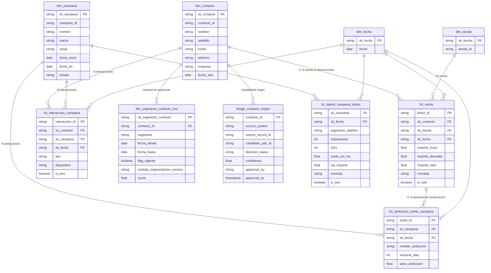

# Modelo dimensional inicial — Propuesta

Destino analítico: BigQuery
Fuentes: identity_crosswalk, contactos, segmentos_contacto_hist, campanas, spend_campana_diario, interacciones_campana, ventas_offline, atribucion_venta_campana

---

## 1. Hechos candidatos

### fct_venta
- **Grano declarado:** una fila representa un ticket de venta offline completo (no existe fuente de líneas de producto, así que no se desglosa por artículo).
- **Clave natural:** `ticket_id`
- **Medidas:** `importe_bruto`, `importe_devuelto`, `importe_neto`
- **Dimensiones relacionadas:** dim_tienda, dim_fecha (por `fecha_hora_venta`), dim_contacto (puede ser el miembro "desconocido" si la venta es anónima)
- **Atributos degenerados:** `moneda`, `is_test`
- Nota: **no** incluye `campana_id`. La relación venta↔campaña vive en `fct_atribucion_venta_campana`.

### fct_atribucion_venta_campana (bridge / hecho de factor de peso)
- **Grano declarado:** una fila representa el peso de atribución que un modelo de atribución concreto asigna a una campaña para un ticket dado, con una ventana de atribución determinada.
- **Clave natural:** `ticket_id` + `campana_id` + `modelo_atribucion` + `ventana_dias` (ver decisión abierta sobre unicidad)
- **Medidas:** `peso_atribucion`
- **Dimensiones relacionadas:** dim_campana, dim_fecha (por `fecha_atribucion`), referencia a fct_venta vía `ticket_id`

### fct_interaccion_campana
- **Grano declarado:** una fila representa una interacción puntual de un contacto con una campaña.
- **Clave natural:** `interaccion_id`
- **Medidas:** ninguna medida aditiva propia; es un hecho factless, el recuento de filas es la métrica (soporta el funnel).
- **Dimensiones relacionadas:** dim_contacto, dim_campana, dim_fecha (por `interaccion_at`)
- **Atributos degenerados:** `tipo`, `dispositivo`, `is_test`

### fct_spend_campana_diario
- **Grano declarado:** una fila representa la inversión de una campaña en un día concreto, desglosada por segmento objetivo.
- **Clave natural:** `campana_id` + `fecha` + `segmento_objetivo`
- **Medidas:** `impresiones`, `clics`, `coste_sin_iva`, `iva_importe`
- **Dimensiones relacionadas:** dim_campana, dim_fecha
- **Atributos degenerados:** `segmento_objetivo`, `moneda`, `is_test`

---

## 2. Dimensiones candidatas

### dim_contacto
- **Clave natural:** `contacto_id`
- **Surrogate key:** `sk_contacto`
- **Atributos principales:** `nombre`, `apellido`, `email`, `telefono`, `empresa`, `fecha_alta`
- **Estrategia histórica:** no declarada en la fuente (parece SCD1); ver decisión abierta.
- **Miembro especial:** debe existir una fila "desconocido" (`sk_contacto = -1` o similar) para las ventas sin `contacto_id` (~40% según profiling).

### bridge_contacto_origen (trazabilidad, a partir de identity_crosswalk)
- No es una dimensión de negocio, sino un puente de trazabilidad contacto↔registro de origen.
- **Claves:** `contacto_id` (FK a dim_contacto), `source_system`, `source_record_id`
- **Atributos:** `candidate_pair_id`, `decision_status`, `confidence`, `approved_by`, `approved_at`
- Un `contacto_id` puede tener múltiples registros de origen (N:M contacto↔registro fuente), de ahí el patrón bridge.

### dim_segmento_contacto_hist (SCD2)
- **Clave natural:** `contacto_id` + `fecha_desde`
- **Surrogate key:** `sk_segmento_contacto`
- **Atributos principales:** `segmento`, `modelo_segmentacion_version`, `score`
- **Estrategia histórica:** SCD2 explícita, ya historificada en origen (`fecha_desde`, `fecha_hasta`, `flag_vigente`). Para "segmento en el momento de la venta": join por rango `fecha_hora_venta BETWEEN fecha_desde AND COALESCE(fecha_hasta, '9999-12-31')`.

### dim_campana
- **Clave natural:** `campana_id`
- **Surrogate key:** `sk_campana`
- **Atributos principales:** `nombre`, `marca`, `canal`, `fecha_inicio`, `fecha_fin`, `estado`
- **Estrategia histórica:** no declarada; probablemente SCD1, pero `estado` podría cambiar en el tiempo — ver decisión abierta.

### dim_tienda
- **Clave natural:** `tienda_id`
- **Surrogate key:** `sk_tienda`
- **Atributos principales:** ninguno disponible más allá del propio ID (no hay fuente de atributos de tienda).
- Riesgo: podría modelarse como atributo degenerado en `fct_venta` mientras no exista una fuente de atributos de tienda.

### dim_fecha
- **Clave natural:** `fecha`
- **Surrogate key:** `sk_fecha`
- **Atributos principales:** atributos estándar de calendario (año, mes, trimestre, día de semana, etc.)
- Aviso: estos atributos no proceden de ninguna fuente entregada; es una dimensión sintética estándar, señalado explícitamente porque la regla es no inventar campos.

---

## 3. Relaciones y cardinalidades

- dim_contacto (1) — (N) fct_venta *(0..N; una venta puede no tener contacto → miembro "desconocido")*
- dim_contacto (1) — (N) fct_interaccion_campana
- dim_contacto (1) — (N) dim_segmento_contacto_hist
- dim_contacto (1) — (N) bridge_contacto_origen
- dim_campana (1) — (N) fct_interaccion_campana
- dim_campana (1) — (N) fct_spend_campana_diario
- dim_campana (1) — (N) fct_atribucion_venta_campana
- fct_venta (1) — (N) fct_atribucion_venta_campana *(multi-touch; puede tener 0 filas si no está atribuida)*
- dim_tienda (1) — (N) fct_venta
- dim_fecha (1) — (N) de cada uno de los cuatro hechos, por su fecha correspondiente

---

## 4. Decisiones abiertas (no resueltas)

1. Estrategia histórica de `dim_contacto`: ¿SCD1 o SCD2? No hay indicación en la fuente.
2. Tratamiento de `is_test` en los cuatro hechos: ¿se excluye en vistas de negocio, se marca y se filtra en BI, o se separan en tablas distintas?
3. Grano exacto de `fct_atribucion_venta_campana`: ¿pueden coexistir varios `modelo_atribucion` o `ventana_dias` para el mismo ticket+campaña, o hay siempre un único modelo "vigente" por ticket?
4. Relación semántica entre `segmento_objetivo` (spend) y `segmento` (segmentos_contacto_hist): ¿mismo dominio de valores y versión de modelo, o conceptos distintos?
5. Manejo del miembro "contacto desconocido": ¿fila única -1, o varias filas según motivo (anónimo vs. no resuelto por identity_crosswalk)?
6. Moneda: los datos de ejemplo son todos EUR; ¿se asume moneda única o hay que prever conversión multi-moneda?
7. Estrategia histórica de `dim_campana`: si `estado` cambia, ¿se versiona (SCD2) o se sobrescribe?
8. ¿`dim_tienda` como dimensión propia o como atributo degenerado en `fct_venta`?
9. Uso de `identity_crosswalk`: ¿el bridge incluye solo `approved_match`, o todos los estados para trazabilidad completa?
10. Necesidad y alcance de `dim_fecha` como dimensión sintética (confirmar si se acepta esta práctica estándar).

---

## 5. Riesgos o datos que faltan para responder las preguntas de negocio

- **ROI por campaña y mes:** no se ha entregado una definición de ROI (fórmula, qué coste incluir —¿con o sin IVA?—, cómo prorratear el ingreso atribuido con peso parcial).
- `fct_spend_campana_diario` está a grano diario y por `segmento_objetivo`, mientras que el ingreso atribuido llega vía `fct_atribucion_venta_campana` a grano ticket; agregar a mes/campaña es factible, pero falta confirmar si `segmento_objetivo` debe cruzarse con el segmento del contacto en la venta.
- **Ingresos netos atribuidos por segmento en el momento de la venta:** el 40% de las ventas son anónimas (sin `contacto_id`), por lo que no tendrán segmento asociado — hay que decidir cómo reportar ese volumen.
- **Funnel de interacciones por campaña:** no se ha entregado un catálogo completo de valores posibles de `tipo` (solo "clic" y "visita" en el muestreo); sin conocer todos los estados no se puede garantizar que las etapas propuestas sean completas.
- **Ventas sin identificar y sin atribuir:** "sin identificar" es directo (`contacto_id` nulo, ~40%). "Sin atribuir" requiere comprobar, para cada ticket, si existe alguna fila en `fct_atribucion_venta_campana` y si la suma de `peso_atribucion` es significativamente menor que 1; no hay una query de profiling que muestre hoy ese porcentaje ni la distribución de sumas de peso por ticket.
- La query 6 confirma integridad referencial (no hay huérfanos), pero no informa sobre cobertura de atribución.

---

## 6. ERD (Mermaid)

---

Este es un punto de partida para discusión — las decisiones abiertas de la sección 4 y los riesgos de la 5 deberían resolverse con el equipo de negocio antes de pasar a particionado, clustering o carga.
