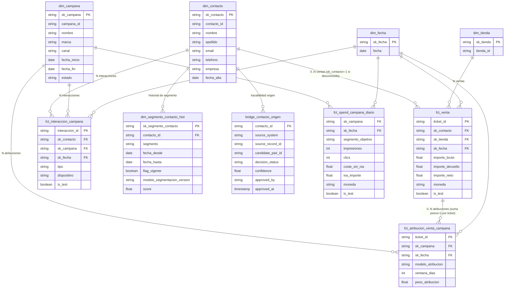

# Revisión v1 → v2

## 1. Diff v1 → v2

**Confirmado sin cambios estructurales** (las decisiones firmadas ratifican lo que v1 ya proponía):
- Grano de `fct_venta` (una fila = ticket completo).
- `dim_segmento_contacto_hist` como SCD2 con join por rango de fechas.
- No modelar producto (no hay fuente, no hay pregunta de negocio que lo requiera).
- `bridge_contacto_origen` se mantiene como derivado de `identity_crosswalk`, conservado como artefacto de integración.

**Modificado:**
- **`fct_atribucion_venta_campana`**: se añade la regla de integridad `SUM(peso_atribucion) POR ticket_id = 1` (para la configuración vigente cargada). Esto acota — pero no cierra del todo — la decisión abierta sobre coexistencia de `modelo_atribucion`/`ventana_dias`: no se especifica si pueden convivir varias combinaciones vigentes simultáneas o cómo tratar el histórico de modelos.
- **`dim_contacto`**: el miembro "desconocido" queda fijado como **una única fila** (`sk_contacto = -1`), no varias filas por motivo. Esto cierra la decisión abierta nº5 de v1.

**Eliminado:** ninguna entidad, hecho, dimensión ni bridge.

**Añadido:** ninguna entidad nueva. Solo se añade la restricción de integridad anterior (no es un campo nuevo).

**Decisiones que pasan de abiertas a cerradas:** nº5 (miembro desconocido).
**Decisiones acotadas pero no cerradas:** nº3 (grano de atribución).

---

## 2. Modelo v2 completo

### Hechos y grano

**`fct_venta`** — una fila por ticket de venta offline completo. Clave natural `ticket_id`. Medidas: `importe_bruto`, `importe_devuelto`, `importe_neto`. Degenerados: `moneda`, `is_test`. Sin `campana_id` (la atribución vive en el bridge de atribución).

**`fct_atribucion_venta_campana`** — una fila por peso de atribución de una campaña sobre un ticket, para un modelo y ventana dados. Clave natural `ticket_id + campana_id + modelo_atribucion + ventana_dias`. Medida: `peso_atribucion`. **Regla de integridad (firmada):** `SUM(peso_atribucion)` agrupado por `ticket_id` = 1, para la configuración vigente cargada.

**`fct_interaccion_campana`** — factless, una fila por interacción puntual contacto↔campaña. Clave natural `interaccion_id`. Degenerados: `tipo`, `dispositivo`, `is_test`.

**`fct_spend_campana_diario`** — una fila por campaña, día y segmento objetivo. Clave natural `campana_id + fecha + segmento_objetivo`. Medidas: `impresiones`, `clics`, `coste_sin_iva`, `iva_importe`.

### Dimensiones y estrategia histórica

- **`dim_contacto`** — clave natural `contacto_id`, surrogate `sk_contacto`. Estrategia histórica no declarada (abierta). Miembro especial único: `sk_contacto = -1` para ventas sin contacto (cerrado).
- **`dim_segmento_contacto_hist`** — SCD2 explícita (`fecha_desde`, `fecha_hasta`, `flag_vigente`). Clave natural `contacto_id + fecha_desde`, surrogate `sk_segmento_contacto`.
- **`dim_campana`** — clave natural `campana_id`, surrogate `sk_campana`. Estrategia histórica no declarada; abierta si `estado` requiere SCD2.
- **`dim_tienda`** — clave natural `tienda_id`, surrogate `sk_tienda`. Sin atributos propios; abierto si debe seguir siendo dimensión o convertirse en degenerado.
- **`dim_fecha`** — sintética estándar; su inclusión sigue abierta a confirmación.

### Bridges

- **`bridge_contacto_origen`** — trazabilidad contacto↔registro de origen (N:M), a partir de `identity_crosswalk`, conservado como artefacto de integración. Claves: `contacto_id` (FK) + `source_system` + `source_record_id`. Atributos: `candidate_pair_id`, `decision_status`, `confidence`, `approved_by`, `approved_at`. Abierto: si incluye solo `approved_match` o todos los estados.

### Claves naturales y surrogate

Sin cambios respecto a v1 (ver ERD). No se introduce sufijo `_nk` porque no hay decisión firmada al respecto; se mantiene la convención ya usada en v1.

### Relaciones y cardinalidades

- `dim_contacto (1) — (N) fct_venta` (0..N; el miembro -1 cubre las ventas sin contacto, decisión cerrada)
- `dim_contacto (1) — (N) fct_interaccion_campana`
- `dim_contacto (1) — (N) dim_segmento_contacto_hist`
- `dim_contacto (1) — (N) bridge_contacto_origen`
- `dim_campana (1) — (N) fct_interaccion_campana`
- `dim_campana (1) — (N) fct_spend_campana_diario`
- `dim_campana (1) — (N) fct_atribucion_venta_campana`
- `fct_venta (1) — (N) fct_atribucion_venta_campana` (multi-touch; suma de pesos = 1 por ticket, decisión firmada)
- `dim_tienda (1) — (N) fct_venta`
- `dim_fecha (1) — (N)` de cada uno de los cuatro hechos

---

## 3. Decisiones que siguen abiertas

1. Estrategia histórica de `dim_contacto` (SCD1 vs SCD2).
2. Tratamiento de `is_test` en los cuatro hechos.
3. Grano exacto de `fct_atribucion_venta_campana`: acotado por la regla de suma=1, pero sin resolver si coexisten varias combinaciones `modelo_atribucion`/`ventana_dias` vigentes o cómo tratar el histórico de modelos.
4. Relación semántica entre `segmento_objetivo` (spend) y `segmento` (contacto).
5. Moneda: EUR único vs. multi-moneda.
6. Estrategia histórica de `dim_campana` (¿`estado` se versiona?).
7. `dim_tienda`: ¿dimensión propia o atributo degenerado en `fct_venta`?
8. Alcance de `identity_crosswalk` en el bridge: ¿solo `approved_match` o todos los estados?
9. Necesidad y alcance de `dim_fecha` sintética.
10. **ROI**: sigue explícitamente abierto (fórmula, coste con/sin IVA, prorrateo por peso de atribución) — no resuelto por instrucción expresa.

---

## 4. ERD Mermaid (v2)

