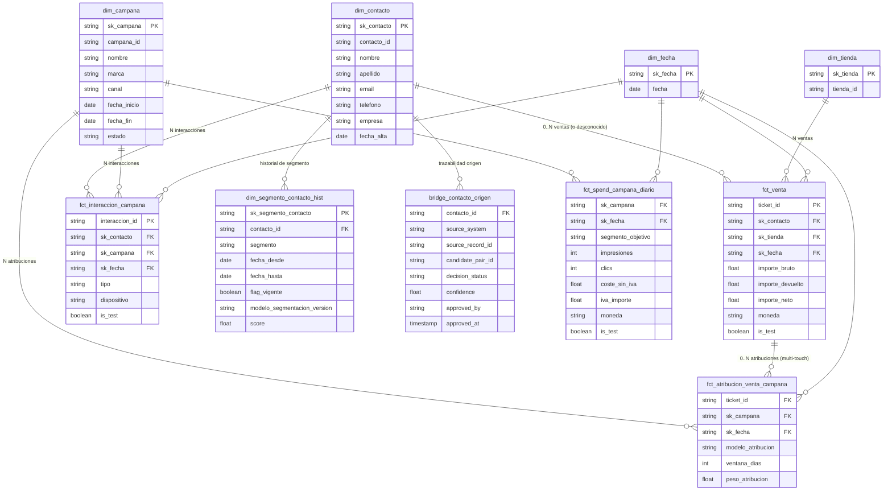

# Prompts completos — Sesión 2 (montados con material real)

Generado por `scripts/montar_prompts.py` a partir de `data/`, `output/` y
`contexto.md`. Prompt 1 y 2 van ya llenos (fuentes, profiling, output v1 bruto y
tabla de firmas). El prompt 3 toma `<modelo_v2>` de `output/modelo_v2.md` si existe
el ensayo v2; si no, queda el placeholder.

---

## 1. Modelo v1

```text
Tarea: propón un modelo dimensional inicial para el caso descrito.

Contexto:
- El destino analítico es BigQuery.
- Las convenciones y el glosario están en <contexto_equipo>.
- Las fuentes y sus resultados de profiling están en <fuentes>.
- Las preguntas que debe responder el modelo están en <preguntas_negocio>.

Entregable:
1. Hechos candidatos. Para cada uno:
   - nombre;
   - grano declarado: «una fila representa...»;
   - clave natural o de negocio;
   - medidas;
   - dimensiones relacionadas.
2. Dimensiones candidatas:
   - clave natural;
   - surrogate key;
   - atributos principales;
   - estrategia histórica si aplica.
3. Relaciones y cardinalidades.
4. Lista de DECISIONES ABIERTAS. No las resuelvas.
5. Riesgos o datos que faltan para responder las preguntas de negocio.
6. ERD en Mermaid.

Reglas:
- No inventes entidades ni campos que no aparezcan en las fuentes.
- No diseñes producto: no existe una fuente de líneas de ticket.
- No pongas campana_id directamente en la venta si la relación procede de la tabla de atribución.
- Conserva la trazabilidad de IDs de origen mediante identity_crosswalk.
- No propongas todavía particionado ni clustering.
- No inventes la definición de ROI.

<contexto_equipo>
# Equipo Data — Contexto para modelado (S2)

Versión acotada de `EQUIPO_DATA.md` para la sesión de modelado. No incluye el modelo
canónico ni referencias a tablas gold existentes: el modelo se diseña en clase.

## Naming

- Datasets: raw, staging, silver, gold.
- Hechos: fct_*; dimensiones: dim_*; puentes: bridge_*.
- Surrogate keys: sk_*.
- Claves naturales: *_nk.
- Fechas de vigencia: fecha_desde, fecha_hasta, flag_vigente.

## Glosario

- Lead: contacto todavía no cualificado.
- Contacto: entidad canónica de persona.
- Campaña: unidad de inversión con vigencia y canal.
- Interacción: evento de un contacto con una campaña.
- Venta: ticket offline completo.

## Reglas de diseño

- No inventes fuentes, campos ni entidades.
- Declara el grano de cada hecho.
- Enumera DECISIONES ABIERTAS.
- No decidas source of truth ni métricas por nosotros.
</contexto_equipo>

<preguntas_negocio>
- ROI por campaña y mes.
- Ingresos netos atribuidos por segmento en el momento de la venta.
- Funnel de interacciones por campaña.
- Ventas sin identificar y sin atribuir.
</preguntas_negocio>

<fuentes>
### identity_crosswalk.csv

```
contacto_id,source_system,source_record_id,candidate_pair_id,decision_status,confidence,approved_by,approved_at
CT000048,crm,L344942,33,rejected_match,0.94,marketing_ops,2026-09-08 18:30:00 UTC
CT000192,crm,L850069,,sin_candidato,,,
CT000129,crm,L605407,8,approved_match,0.96,marketing_ops,2026-09-08 18:30:00 UTC
```

### contactos.csv

```
contacto_id,nombre,apellido,email,telefono,empresa,fecha_alta
CT000001,Laura,Gómez,laura.gomez@tecnoandar.com,+34690144805,TecnoAndar,2025-12-07
CT000002,Javier,Pérez,javier.perez@acme.com,+34662155287,Acme Retail,2025-10-10
CT000003,Laura,García,,+34685681247,Vela Hogar,2026-05-29
```

### segmentos_contacto_hist.csv

```
contacto_id,segmento,fecha_desde,fecha_hasta,flag_vigente,modelo_segmentacion_version,score
CT000001,recurrente,2025-12-07,2026-01-27,false,v2025.4,65.2
CT000001,nuevo,2026-01-27,,true,v2026.2,92.7
CT000002,nuevo,2025-10-10,2026-01-29,false,v2025.4,81.8
```

### campanas.csv

```
campana_id,nombre,marca,canal,fecha_inicio,fecha_fin,estado
C00001,Belleza · email · otoño 2025,Belleza,email,2025-10-10,2025-11-13,archivada
C00002,Alimentación · display · invierno 2025-26,Alimentación,display,2025-12-17,2026-01-21,archivada
C00003,Electrónica · SEM · primavera 2026,Electrónica,paid_search,2026-03-25,2026-05-06,finalizada
```

### spend_campana_diario.csv

```
campana_id,fecha,segmento_objetivo,impresiones,clics,coste_sin_iva,iva_importe,moneda,is_test
C00001,2025-10-10,nuevo,2067,33,556.60,116.89,EUR,false
C00001,2025-10-10,alto_valor,24823,555,473.07,99.34,EUR,false
C00001,2025-10-11,nuevo,44389,998,534.23,112.19,EUR,false
```

### interacciones_campana.csv

```
interaccion_id,contacto_id,campana_id,interaccion_at,tipo,dispositivo,is_test
IN00016143,CT000320,C00032,2026-06-06 19:14:15 UTC,clic,mobile,false
IN00015044,CT000087,C00037,2026-04-03 18:06:57 UTC,clic,mobile,false
IN00012889,CT000249,C00036,2026-06-23 00:02:14 UTC,visita,mobile,false
```

### ventas_offline.csv

```
ticket_id,tienda_id,fecha_hora_venta,contacto_id,importe_bruto,importe_devuelto,importe_neto,moneda,is_test
TK00001377,T034,2026-05-05 15:09:02 UTC,CT000199,832.14,0.00,832.14,EUR,false
TK00000119,T027,2026-01-26 14:39:02 UTC,CT000194,1325.31,0.00,1325.31,EUR,false
TK00001359,T012,2026-06-04 12:04:41 UTC,CT000035,1264.96,0.00,1264.96,EUR,false
```

### atribucion_venta_campana.csv

```
ticket_id,campana_id,modelo_atribucion,ventana_dias,peso_atribucion,fecha_atribucion
TK00000693,C00043,posicion,30,0.07,2026-05-31
TK00000031,C00025,lineal,30,0.10,2025-11-05
TK00001027,C00013,lineal,30,0.20,2025-10-22
```

## Resultados de las queries de profiling

### Query 1 grano ventas

```
+-------+---------+-------------+
| filas | tickets | tickets_dia |
+-------+---------+-------------+
|  5000 |    5000 |        5000 |
+-------+---------+-------------+
```

### Query 2 anonimas test

```
+-------+----------+--------------+-------------+
| total | anonimas | pct_anonimas | ventas_test |
+-------+----------+--------------+-------------+
|  5000 |     2000 |          0.4 |         100 |
+-------+----------+--------------+-------------+
```

### Query 3 segmento vigente

0 filas (sin violaciones que listar).

### Query 4 solapes scd2

0 filas (sin violaciones que listar).

### Query 5 pesos atribucion

0 filas (sin violaciones que listar).

### Query 6 integridad referencial

```
+--------------------------+-------------------------------+
| ventas_contacto_huerfano | atribuciones_campana_huerfana |
+--------------------------+-------------------------------+
|                        0 |                             0 |
+--------------------------+-------------------------------+
```
</fuentes>
```

---

## 2. Iteración v2 (completa — modelo_v1 y firmas incrustados)

```text
Revisa la propuesta v1 utilizando exclusivamente las decisiones aprobadas de <decisiones_firmadas>.

Devuelve:
1. Un diff v1 → v2 con elementos añadidos, eliminados y modificados.
2. El modelo v2 completo:
   - hechos y grano;
   - dimensiones y estrategia histórica;
   - bridges;
   - claves naturales y surrogate;
   - relaciones y cardinalidades.
3. Las decisiones que siguen abiertas.
4. Un ERD Mermaid compilable.

Reglas:
- No inventes nuevas entidades.
- No resuelvas la definición de ROI: sigue abierta.
- No propongas particionado o clustering todavía.
- Conserva identity_crosswalk como artefacto de integración.

<propuesta_v1>
# Modelo dimensional inicial — Propuesta

Destino analítico: BigQuery
Fuentes: identity_crosswalk, contactos, segmentos_contacto_hist, campanas, spend_campana_diario, interacciones_campana, ventas_offline, atribucion_venta_campana

---

## 1. Hechos candidatos

### fct_venta
- **Grano declarado:** una fila representa un ticket de venta offline completo (no existe fuente de líneas de producto, así que no se desglosa por artículo).
- **Clave natural:** `ticket_id`
- **Medidas:** `importe_bruto`, `importe_devuelto`, `importe_neto`
- **Dimensiones relacionadas:** dim_tienda, dim_fecha (por `fecha_hora_venta`), dim_contacto (puede ser el miembro "desconocido" si la venta es anónima)
- **Atributos degenerados:** `moneda`, `is_test`
- Nota: **no** incluye `campana_id`. La relación venta↔campaña vive en `fct_atribucion_venta_campana`.

### fct_atribucion_venta_campana (bridge / hecho de factor de peso)
- **Grano declarado:** una fila representa el peso de atribución que un modelo de atribución concreto asigna a una campaña para un ticket dado, con una ventana de atribución determinada.
- **Clave natural:** `ticket_id` + `campana_id` + `modelo_atribucion` + `ventana_dias` (ver decisión abierta sobre unicidad)
- **Medidas:** `peso_atribucion`
- **Dimensiones relacionadas:** dim_campana, dim_fecha (por `fecha_atribucion`), referencia a fct_venta vía `ticket_id`

### fct_interaccion_campana
- **Grano declarado:** una fila representa una interacción puntual de un contacto con una campaña.
- **Clave natural:** `interaccion_id`
- **Medidas:** ninguna medida aditiva propia; es un hecho factless, el recuento de filas es la métrica (soporta el funnel).
- **Dimensiones relacionadas:** dim_contacto, dim_campana, dim_fecha (por `interaccion_at`)
- **Atributos degenerados:** `tipo`, `dispositivo`, `is_test`

### fct_spend_campana_diario
- **Grano declarado:** una fila representa la inversión de una campaña en un día concreto, desglosada por segmento objetivo.
- **Clave natural:** `campana_id` + `fecha` + `segmento_objetivo`
- **Medidas:** `impresiones`, `clics`, `coste_sin_iva`, `iva_importe`
- **Dimensiones relacionadas:** dim_campana, dim_fecha
- **Atributos degenerados:** `segmento_objetivo`, `moneda`, `is_test`

---

## 2. Dimensiones candidatas

### dim_contacto
- **Clave natural:** `contacto_id`
- **Surrogate key:** `sk_contacto`
- **Atributos principales:** `nombre`, `apellido`, `email`, `telefono`, `empresa`, `fecha_alta`
- **Estrategia histórica:** no declarada en la fuente (parece SCD1); ver decisión abierta.
- **Miembro especial:** debe existir una fila "desconocido" (`sk_contacto = -1` o similar) para las ventas sin `contacto_id` (~40% según profiling).

### bridge_contacto_origen (trazabilidad, a partir de identity_crosswalk)
- No es una dimensión de negocio, sino un puente de trazabilidad contacto↔registro de origen.
- **Claves:** `contacto_id` (FK a dim_contacto), `source_system`, `source_record_id`
- **Atributos:** `candidate_pair_id`, `decision_status`, `confidence`, `approved_by`, `approved_at`
- Un `contacto_id` puede tener múltiples registros de origen (N:M contacto↔registro fuente), de ahí el patrón bridge.

### dim_segmento_contacto_hist (SCD2)
- **Clave natural:** `contacto_id` + `fecha_desde`
- **Surrogate key:** `sk_segmento_contacto`
- **Atributos principales:** `segmento`, `modelo_segmentacion_version`, `score`
- **Estrategia histórica:** SCD2 explícita, ya historificada en origen (`fecha_desde`, `fecha_hasta`, `flag_vigente`). Para "segmento en el momento de la venta": join por rango `fecha_hora_venta BETWEEN fecha_desde AND COALESCE(fecha_hasta, '9999-12-31')`.

### dim_campana
- **Clave natural:** `campana_id`
- **Surrogate key:** `sk_campana`
- **Atributos principales:** `nombre`, `marca`, `canal`, `fecha_inicio`, `fecha_fin`, `estado`
- **Estrategia histórica:** no declarada; probablemente SCD1, pero `estado` podría cambiar en el tiempo — ver decisión abierta.

### dim_tienda
- **Clave natural:** `tienda_id`
- **Surrogate key:** `sk_tienda`
- **Atributos principales:** ninguno disponible más allá del propio ID (no hay fuente de atributos de tienda).
- Riesgo: podría modelarse como atributo degenerado en `fct_venta` mientras no exista una fuente de atributos de tienda.

### dim_fecha
- **Clave natural:** `fecha`
- **Surrogate key:** `sk_fecha`
- **Atributos principales:** atributos estándar de calendario (año, mes, trimestre, día de semana, etc.)
- Aviso: estos atributos no proceden de ninguna fuente entregada; es una dimensión sintética estándar, señalado explícitamente porque la regla es no inventar campos.

---

## 3. Relaciones y cardinalidades

- dim_contacto (1) — (N) fct_venta *(0..N; una venta puede no tener contacto → miembro "desconocido")*
- dim_contacto (1) — (N) fct_interaccion_campana
- dim_contacto (1) — (N) dim_segmento_contacto_hist
- dim_contacto (1) — (N) bridge_contacto_origen
- dim_campana (1) — (N) fct_interaccion_campana
- dim_campana (1) — (N) fct_spend_campana_diario
- dim_campana (1) — (N) fct_atribucion_venta_campana
- fct_venta (1) — (N) fct_atribucion_venta_campana *(multi-touch; puede tener 0 filas si no está atribuida)*
- dim_tienda (1) — (N) fct_venta
- dim_fecha (1) — (N) de cada uno de los cuatro hechos, por su fecha correspondiente

---

## 4. Decisiones abiertas (no resueltas)

1. Estrategia histórica de `dim_contacto`: ¿SCD1 o SCD2? No hay indicación en la fuente.
2. Tratamiento de `is_test` en los cuatro hechos: ¿se excluye en vistas de negocio, se marca y se filtra en BI, o se separan en tablas distintas?
3. Grano exacto de `fct_atribucion_venta_campana`: ¿pueden coexistir varios `modelo_atribucion` o `ventana_dias` para el mismo ticket+campaña, o hay siempre un único modelo "vigente" por ticket?
4. Relación semántica entre `segmento_objetivo` (spend) y `segmento` (segmentos_contacto_hist): ¿mismo dominio de valores y versión de modelo, o conceptos distintos?
5. Manejo del miembro "contacto desconocido": ¿fila única -1, o varias filas según motivo (anónimo vs. no resuelto por identity_crosswalk)?
6. Moneda: los datos de ejemplo son todos EUR; ¿se asume moneda única o hay que prever conversión multi-moneda?
7. Estrategia histórica de `dim_campana`: si `estado` cambia, ¿se versiona (SCD2) o se sobrescribe?
8. ¿`dim_tienda` como dimensión propia o como atributo degenerado en `fct_venta`?
9. Uso de `identity_crosswalk`: ¿el bridge incluye solo `approved_match`, o todos los estados para trazabilidad completa?
10. Necesidad y alcance de `dim_fecha` como dimensión sintética (confirmar si se acepta esta práctica estándar).

---

## 5. Riesgos o datos que faltan para responder las preguntas de negocio

- **ROI por campaña y mes:** no se ha entregado una definición de ROI (fórmula, qué coste incluir —¿con o sin IVA?—, cómo prorratear el ingreso atribuido con peso parcial).
- `fct_spend_campana_diario` está a grano diario y por `segmento_objetivo`, mientras que el ingreso atribuido llega vía `fct_atribucion_venta_campana` a grano ticket; agregar a mes/campaña es factible, pero falta confirmar si `segmento_objetivo` debe cruzarse con el segmento del contacto en la venta.
- **Ingresos netos atribuidos por segmento en el momento de la venta:** el 40% de las ventas son anónimas (sin `contacto_id`), por lo que no tendrán segmento asociado — hay que decidir cómo reportar ese volumen.
- **Funnel de interacciones por campaña:** no se ha entregado un catálogo completo de valores posibles de `tipo` (solo "clic" y "visita" en el muestreo); sin conocer todos los estados no se puede garantizar que las etapas propuestas sean completas.
- **Ventas sin identificar y sin atribuir:** "sin identificar" es directo (`contacto_id` nulo, ~40%). "Sin atribuir" requiere comprobar, para cada ticket, si existe alguna fila en `fct_atribucion_venta_campana` y si la suma de `peso_atribucion` es significativamente menor que 1; no hay una query de profiling que muestre hoy ese porcentaje ni la distribución de sumas de peso por ticket.
- La query 6 confirma integridad referencial (no hay huérfanos), pero no informa sobre cobertura de atribución.

---

## 6. ERD (Mermaid)



---

Este es un punto de partida para discusión — las decisiones abiertas de la sección 4 y los riesgos de la 5 deberían resolverse con el equipo de negocio antes de pasar a particionado, clustering o carga.
</propuesta_v1>

<decisiones_firmadas>
| Decisión | Resolución | Evidencia | Firma |
|---|---|---|---|
| Grano de venta | Una fila por ticket completo | Unicidad + sistema origen | Owner de ventas + ingeniería |
| Ventas anónimas | Se conservan con `sk_contacto` desconocido | 40% sin ID | Negocio |
| Segmento | SCD2; se usa el vigente en la fecha de venta | Snapshot mensual | Marketing |
| Atribución | Bridge con pesos; pesos por ticket suman 1 | Fuente de atribución | Marketing Analytics |
| Producto | No se modela | No hay fuente ni pregunta | Ingeniería |
| IDs origen | Se conservan en crosswalk | Traspaso S1 | Data Governance |
| ROI | Sigue abierto hasta definir coste, devoluciones y atribución | Fuentes + Finanzas | Finanzas + Marketing |
</decisiones_firmadas>
```

---

## 3. DDL y tests

```text
Genera BigQuery Standard SQL para materializar el modelo v2 aprobado.

Entregables:
1. DDL de dimensiones, hechos y bridge.
2. SQL de carga SCD2 para la dimensión de historia del segmento (la del modelo v2).
3. Tests SQL que devuelvan cero filas para:
   - unicidad del grano;
   - claves obligatorias;
   - integridad referencial;
   - intervalos SCD2 solapados;
   - más de una fila vigente por contacto;
   - pesos de atribución que no sumen 1.
4. DECISIONES ABIERTAS que impidan generar una pieza correctamente.
5. Diccionario de datos de las tablas gold_*: para cada tabla, descripción de una
   línea, grano, clave, y cada columna con tipo y definición de negocio. Marca las
   decisiones abiertas que afecten a cada pieza; no las resuelvas.

Reglas:
- Usa los nombres y tipos del modelo v2.
- No inventes columnas.
- El diccionario se deriva del DDL: toda tabla y columna del DDL debe aparecer
  documentada, ni más ni menos.
- No generes la query de ROI todavía.
- No propongas particionado o clustering sin patrones de consulta y volumetría.

<modelo_v2>
## 2. Modelo v2 completo

### Hechos y grano

**`fct_venta`** — una fila por ticket de venta offline completo. Clave natural `ticket_id`. Medidas: `importe_bruto`, `importe_devuelto`, `importe_neto`. Degenerados: `moneda`, `is_test`. Sin `campana_id` (la atribución vive en el bridge de atribución).

**`fct_atribucion_venta_campana`** — una fila por peso de atribución de una campaña sobre un ticket, para un modelo y ventana dados. Clave natural `ticket_id + campana_id + modelo_atribucion + ventana_dias`. Medida: `peso_atribucion`. **Regla de integridad (firmada):** `SUM(peso_atribucion)` agrupado por `ticket_id` = 1, para la configuración vigente cargada.

**`fct_interaccion_campana`** — factless, una fila por interacción puntual contacto↔campaña. Clave natural `interaccion_id`. Degenerados: `tipo`, `dispositivo`, `is_test`.

**`fct_spend_campana_diario`** — una fila por campaña, día y segmento objetivo. Clave natural `campana_id + fecha + segmento_objetivo`. Medidas: `impresiones`, `clics`, `coste_sin_iva`, `iva_importe`.

### Dimensiones y estrategia histórica

- **`dim_contacto`** — clave natural `contacto_id`, surrogate `sk_contacto`. Estrategia histórica no declarada (abierta). Miembro especial único: `sk_contacto = -1` para ventas sin contacto (cerrado).
- **`dim_segmento_contacto_hist`** — SCD2 explícita (`fecha_desde`, `fecha_hasta`, `flag_vigente`). Clave natural `contacto_id + fecha_desde`, surrogate `sk_segmento_contacto`.
- **`dim_campana`** — clave natural `campana_id`, surrogate `sk_campana`. Estrategia histórica no declarada; abierta si `estado` requiere SCD2.
- **`dim_tienda`** — clave natural `tienda_id`, surrogate `sk_tienda`. Sin atributos propios; abierto si debe seguir siendo dimensión o convertirse en degenerado.
- **`dim_fecha`** — sintética estándar; su inclusión sigue abierta a confirmación.

### Bridges

- **`bridge_contacto_origen`** — trazabilidad contacto↔registro de origen (N:M), a partir de `identity_crosswalk`, conservado como artefacto de integración. Claves: `contacto_id` (FK) + `source_system` + `source_record_id`. Atributos: `candidate_pair_id`, `decision_status`, `confidence`, `approved_by`, `approved_at`. Abierto: si incluye solo `approved_match` o todos los estados.

### Claves naturales y surrogate

Sin cambios respecto a v1 (ver ERD). No se introduce sufijo `_nk` porque no hay decisión firmada al respecto; se mantiene la convención ya usada en v1.

### Relaciones y cardinalidades

- `dim_contacto (1) — (N) fct_venta` (0..N; el miembro -1 cubre las ventas sin contacto, decisión cerrada)
- `dim_contacto (1) — (N) fct_interaccion_campana`
- `dim_contacto (1) — (N) dim_segmento_contacto_hist`
- `dim_contacto (1) — (N) bridge_contacto_origen`
- `dim_campana (1) — (N) fct_interaccion_campana`
- `dim_campana (1) — (N) fct_spend_campana_diario`
- `dim_campana (1) — (N) fct_atribucion_venta_campana`
- `fct_venta (1) — (N) fct_atribucion_venta_campana` (multi-touch; suma de pesos = 1 por ticket, decisión firmada)
- `dim_tienda (1) — (N) fct_venta`
- `dim_fecha (1) — (N)` de cada uno de los cuatro hechos

---


## 3. Decisiones que siguen abiertas

1. Estrategia histórica de `dim_contacto` (SCD1 vs SCD2).
2. Tratamiento de `is_test` en los cuatro hechos.
3. Grano exacto de `fct_atribucion_venta_campana`: acotado por la regla de suma=1, pero sin resolver si coexisten varias combinaciones `modelo_atribucion`/`ventana_dias` vigentes o cómo tratar el histórico de modelos.
4. Relación semántica entre `segmento_objetivo` (spend) y `segmento` (contacto).
5. Moneda: EUR único vs. multi-moneda.
6. Estrategia histórica de `dim_campana` (¿`estado` se versiona?).
7. `dim_tienda`: ¿dimensión propia o atributo degenerado en `fct_venta`?
8. Alcance de `identity_crosswalk` en el bridge: ¿solo `approved_match` o todos los estados?
9. Necesidad y alcance de `dim_fecha` sintética.
10. **ROI**: sigue explícitamente abierto (fórmula, coste con/sin IVA, prorrateo por peso de atribución) — no resuelto por instrucción expresa.

---
</modelo_v2>
```

## 4. Query ROI (tras firmar el contrato semántico)

Se ejecuta solo después de la tabla de decisiones de la métrica. El resultado mostrado
en el deck será el observado tras materializar `gold_*`, nunca una cifra narrativa, y
lleva reconciliación manual de una campaña.

```text
Genera BigQuery Standard SQL para la métrica de <contrato>
# Contrato semántico roi_campana_mes
# Redactado desde la tabla de firmas de negocio (contexto.md §11). La query
# solo puede derivarse de este fichero; nada de aquí lo decide el LLM.
# Nombres de tablas: modelo v2 real (ensayo), no la referencia de §9.
metrica: roi_campana_mes
grano: campana + mes
owner: marketing-analytics

numerador:
  formula: ingresos_netos_atribuidos - coste_sin_iva

denominador:
  formula: coste_sin_iva

ingresos_netos_atribuidos:
  fuente: fct_venta + fct_atribucion_venta_campana
  formula: SUM(importe_neto * peso_atribucion)

coste_sin_iva:
  fuente: fct_spend_campana_diario
  formula: SUM(coste_sin_iva)

filtros_obligatorios:
  - is_test = FALSE

segmento:
  regla: usar la fila SCD vigente en fecha de venta

casos_limite:
  - coste_sin_iva = 0 → ROI null
  - venta sin atribución → no entra en ROI de campaña
</contrato>

<ddl_gold>
[DDL REAL — output/ddl_modelo_v2.sql, tras el ensayo del prompt 3]
</ddl_gold>
```
